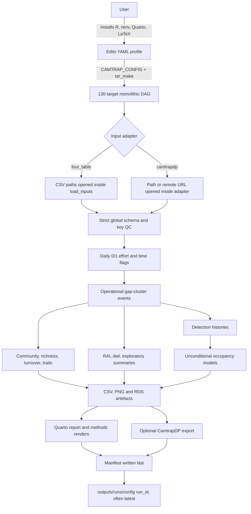
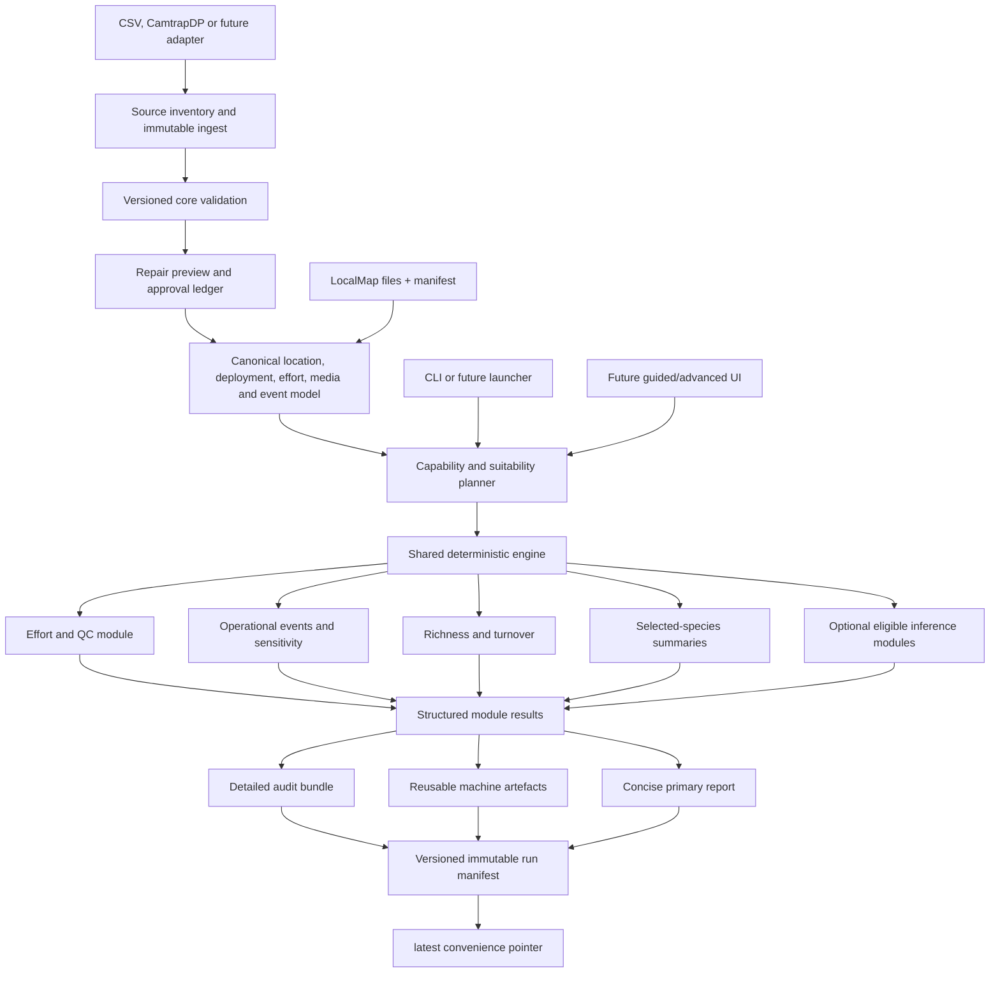

# Goal 002 product and architecture audit

## Status and scope

**Audit status:** `DONE_WITH_CONCERNS`.

**Observed.** Camtrap Workflow is a substantial, output-rich R/`targets` system with broad unit coverage, deterministic reports, five exercised configuration profiles, and an accepted portability baseline. Goal 001 rebuilt all 130 targets for five native configurations and a container default run; those executions predate the packet-publication commit and establish prior technical operation, not current scientific validity (`docs/goals/001-r46-mac-mini-readiness-acceptance/Log.md:40`, `docs/goals/001-r46-mac-mini-readiness-acceptance/Log.md:58`).

**Inference.** The repository contains domain knowledge worth preserving, but its present architecture is a monolithic scientific project rather than the agreed product: source data are hidden pipeline dependencies, run identity is mutable, a strict Judbury-shaped schema controls every project, modules cannot fail softly, and users must operate R or shell commands.

**Recommendation.** Do not rewrite the analyses and do not choose a GUI. Authorize a bounded first renovation tranche that makes inputs explicit, creates one immutable run identity, adds capability and module-status contracts, and separates primary, audit, and reusable outputs. Preserve existing functions behind compatibility adapters while Goal 003 compares external standards, products, and interface options.

**Uncertainty.** Static evidence cannot prove runtime behavior at packet HEAD `06ceb5ca1ac5804f71131fdebf35abc867589b1e`. Six ignored cached manifests and their outputs are retained from Goal 001 at earlier source commit `b13c7fe...`; they are presence and prior-run evidence only.

## Epistemic labels

- **Observed:** directly visible in source, configuration, tests, documentation, retained artefacts, or accepted Goal 001 evidence.
- **Inference:** an architectural, product, or scientific interpretation of observed evidence.
- **Recommendation:** a proposed future action, not implemented by Goal 002.
- **Uncertainty:** a material fact that the authorized static surface cannot resolve.

## Inventory status definitions

- `implemented_and_evidenced`: implementation is present and has focused test evidence and/or accepted Goal 001 end-to-end evidence. This status means technically exercised; it does not certify scientific suitability.
- `implemented_unverified`: implementation is present but neither focused test evidence nor accepted retained execution evidence was found.
- `partial`: part of the stated contract exists, but important behavior, evidence, or alignment is missing.
- `docs_only`: a described capability has no implementation evidence.
- `obsolete_or_duplicated`: the surface is stale, superseded, orphaned, or materially duplicated.
- `not_present`: the agreed capability was not found after bounded static search.

## Coverage reconciliation

The complete reconciliation is in [module_inventory.csv](module_inventory.csv).

| Surface | Count | Inventory reconciliation |
| --- | ---: | --- |
| Top-level `R/*.R` files | 27 | `r01`-`r27`; no exclusions |
| Literal `tar_target()` declarations | 130 | `t001`-`t130`; unique names; no exclusions |
| Root configuration profiles | 5 | `cfg1`-`cfg5` |
| `tests/testthat/*.R` files | 24 | `test01`-`test24`; 67 `test_that()` cases |
| Test CSV fixtures | 8 | `fixture01`-`fixture08` |
| Quarto sources | 2 | `qmd01`-`qmd02` |
| Repository scripts | 3 | `script01`-`script03` |
| Reference-contract documents | 7 | `doc01`-`doc07` |
| Public entrypoints | 4 | `entry01`-`entry04` |
| Principal output groups | 7 | `out01`-`out07` |
| Agreed-contract capability records | 12 | `cap01`-`cap12` |
| **Total inventory records** | **229** | Stable unique `record_id` values |

Status totals are 206 `implemented_and_evidenced`, 12 `partial`, 1 `obsolete_or_duplicated`, and 10 `not_present`. No record is classified `implemented_unverified` or `docs_only` because technical implementation either had accepted Goal 001 evidence or was classified against a missing/partial product contract.

The manifest declares 33 table keys, 15 figure keys, one occupancy-model family, two report files, two methods files, one export group, and session information (`_targets.R:1439`, `_targets.R:1474`). `report_inputs.rds` is generated but is not listed in the manifest (`_targets.R:1168`, `_targets.R:1438`).

## Current architecture

**Observed.** Only the YAML is a `format = "file"` source target. `raw_inputs` calls `load_inputs(config)`, which opens CSV paths or a URL inside the function (`_targets.R:193`, `_targets.R:233`, `R/input_loader.R:12`).

**Inference.** An in-place input-file change need not invalidate `raw_inputs`, making stale-data reuse the most serious architectural defect. This is a data-integrity issue, not merely pipeline style.

**Observed.** The run directory is `outputs/runs/config$run_id`, with `latest` the Judbury default, while the manifest writes a fresh UTC timestamp into a separate field also named `run_id` (`config.yml:2`, `_targets.R:210`, `R/run_manifest.R:49`). No overwrite guard or input-content hash exists.

## Current user journey

1. Clone or download the repository, install R, restore `renv`, and install Quarto plus LaTeX (`README.md:21`, `GETTING_STARTED.md:25`).
2. Copy the template directory and manually replace four CSV files (`docs/bring_your_own_data.md:11`).
3. Edit YAML paths, timezone, effort/event settings, module toggles, species, and covariates (`docs/reference/config.md:1`).
4. Run `targets::tar_make()` from R/RStudio or an `Rscript` shell command; select an alternate profile through `CAMTRAP_CONFIG` (`README.md:43`).
5. Wait for one global DAG. Optional report, map, rarefaction, and export switches exist, but occupancy, community, trait, and most descriptive modules run unconditionally (`_targets.R:357`, `_targets.R:512`, `_targets.R:679`).
6. Manually inspect a mutable run folder containing tables, figures, model objects, reports, methods files, export, manifest, and session information (`README.md:63`).
7. Rerun into the same configured folder. No immutable-run guard, capability preview, repair preview, module-status summary, guided launcher, or non-R validation route exists.

Friction and hidden requirements:

- R or shell knowledge is mandatory; RStudio is recommended in newcomer documentation (`GETTING_STARTED.md:58`).
- First setup needs package acquisition; the CamtrapDP example additionally needs its remote URL (`config.camtrapdp_example.yml:13`).
- Quarto and LaTeX are required for the default report path; render errors can stop the global run (`_targets.R:1277`).
- Users must understand the Judbury-shaped schema, 0/1 effort, fixed-offset time, operational event rule, occupancy selection, and interpretation caveats.
- `scripts/update_data_dictionary.R` is sourced from the scientific DAG and can rewrite a tracked repository file (`_targets.R:224`).

## Product-contract conformance

| Agreed requirement | Current evidence | Assessment | Direction |
| --- | --- | --- | --- |
| Repository is the local-first ecological-evidence product | Reproducible repository and deterministic reports exist (`README.md:3`) | Partial | Preserve engine; add product runner and contracts |
| Judbury is reference/validation case, not product schema | Required columns encode Judbury covariates and traits (`R/qc_schema.R:9`) | Gap | Keep Judbury adapter/profile outside minimal core |
| No R/RStudio needed for agency/NGO users | All entrypoints require R, Rscript, targets, or Docker (`README.md:21`) | Gap | Defer launcher technology; keep one engine |
| Workflow begins after labelling; classification is out of scope | Product brief says labelled detections are inputs (`docs/product_brief.md:3`) | Conforms | Retain |
| Local-first and offline primary | Four-table runs are local; one example uses a remote URL (`config.camtrapdp_example.yml:13`) | Partial | Separate acquisition/cache from analysis |
| Docker candidate, GUI neutral, hosted future separate | Docker exists and README says no Shiny (`README.md:16`) | Conforms | Goal 003 decides interface/deployment choices |
| Versioned CSV profiles first-class; CamtrapDP optional | CSV and CamtrapDP modes exist (`R/input_loader.R:12`) | Partial | Add profile/schema versions and explicit source identity |
| LocalMap_Tas remains independent upstream provider | No interface exists; internal interpolation duplicates limited GIS context (`R/spatial_outputs.R:133`) | Gap | Adopt file-plus-manifest candidate boundary |
| Small core plus optional progressive metadata | All site/taxa fields required and effort forbids NA (`R/qc_schema.R:9`) | Gap | Design compatibility-backed minimal internal core |
| Explicit input selection scope | No selection-scope field in config/schema (`R/config.R:7`) | Gap | Add required scope enum |
| Preserve confidence, verification, method and model/annotator provenance if supplied | Observation schema omits these fields (`R/qc_schema.R:70`) | Gap | Preserve optional provenance fields through lineage |
| Accept/preserve raw image-level rows; events link to sources | Raw rows enter memory, but row-level events are not published and unparseable datetimes are filtered (`R/custom_funcs.R:106`) | Partial | Immutable ingest and event-membership ledger |
| Optional blanks/people/vehicles/test/unclassified records | Strict taxa-keyed animal schema provides no declared selection/media scope (`R/qc_schema.R:288`) | Gap | Preserve optional activity/media classes without requiring imagery |
| Modules emit completed/warnings/omitted/failed | No module result envelope; errors propagate (`_targets.R:532`) | Gap | Capability plan plus fail-soft result contract |
| Omitted modules state prerequisites, consequences and remediation | Disabled modules create placeholder files (`R/output_helpers.R:9`) | Gap | Structured omission record |
| Raw inputs immutable | No snapshot/hash/overwrite contract (`R/run_manifest.R:49`) | Gap | Content inventory before any transformation |
| Three repair policy levels | Validation, safe name cleaning, filtering, and adapter filling are not a unified policy (`R/custom_funcs.R:10`) | Gap | Explicit audit/safe/approved policy |
| Repair preview and before/after approval ledger | Not present | Gap | Run-scoped reviewable repair ledger |
| Separate location, deployment interval, analysis site | Native docs collapse repeat deployments; DP maps deploymentID to site (`docs/bring_your_own_data.md:61`) | Gap | Versioned internal entities; preserve adapter |
| Named spatial resolutions per module | Map grid resolution exists but is not a named analytical resolution (`config.yml:21`) | Partial | Named spatial scheme objects |
| Deployment intervals, occasions, named temporal schemes | Fixed occasions exist; deployment interval and named scheme objects do not (`R/detection_history.R:13`) | Partial | Named temporal scheme plus interval lineage |
| Zero versus missing effort is first-class | Effort is 0/1 with no NA (`R/qc_schema.R:247`) | Gap | Ternary state with evidence and uncertainty |
| Deployment interval is conservative effort default | DP derives a daily calendar; native data use a complete matrix (`R/camtrapdp_adapter.R:22`) | Partial | Interval evidence feeds effort-state derivation |
| Optional operational-period inference is reviewable and overrideable | Time flags exist; inference/override ledger does not (`R/time_qc.R:13`) | Gap | Evidence hierarchy, uncertainty and overrides |
| Standard/guided/advanced modes share one engine | One YAML engine exists but no named standard profile or interface modes (`R/config.R:7`) | Partial | Versioned standard profile and resolved config |
| Deterministic report complete without AI | Quarto report is deterministic (`analysis/report.qmd:1`) | Conforms | Retain |
| Optional AI downstream, reviewable, provider/egress explicit | No AI layer exists | Deferred | Goal 003; do not add in first tranche |
| Primary report, audit bundle, machine artefacts separated | One broad report plus machine artefacts; no audit bundle/status index (`analysis/report.qmd:46`) | Gap | Partition publishers without duplicating engine |
| Immutable completed runs; latest is pointer only | Default writes directly to `outputs/runs/latest` (`config.yml:2`) | Critical gap | Unified immutable run ID and replaceable pointer |

## Module-status summary

The current system has four coarse feature switches: spatial map, rarefaction, report, and CamtrapDP export (`config.yml:17`, `config.yml:21`, `config.yml:61`). A disabled target emits a placeholder path, but there is no run-level module table.

Recommended future module result envelope:

| Field | Purpose |
| --- | --- |
| `module_id`, `module_version` | Stable identity |
| `status` | Exactly `completed`, `completed_with_warnings`, `omitted`, or `failed` |
| `prerequisites` | Data and design requirements evaluated before execution |
| `consequences` | Claims or outputs unavailable when omitted/failed |
| `remediation` | Practical next action |
| `warnings` | Structured scientific and technical warnings |
| `inputs`, `outputs` | Content identities and artefact references |
| `spatial_scheme`, `temporal_scheme` | Named resolution and occasion contracts |

Global integrity failures such as unreadable core inputs, broken keys, or corrupt run identity should still stop the run. Analytical ineligibility should not.

## Major findings

### 1. Explicit input identity is the first repair

**Observed.** Input paths and URLs are values inside config, and `load_inputs()` reads them beneath `raw_inputs` (`R/input_loader.R:8`).

**Inference.** The DAG cannot reliably know when external bytes change. The same defect prevents a manifest from proving the input content used.

**Recommendation.** Resolve each adapter to explicit file/content targets before parsing, calculate hashes, and record acquisition/cache state. This is Gap `G001` and must precede other renovation.

### 2. Run identity and provenance are not one contract

**Observed.** Configured folder identity and timestamp manifest identity differ; `latest` is mutable (`_targets.R:214`, `R/run_manifest.R:50`). The manifest records config MD5 and output paths but not input hashes, module states, repairs, warnings, or artefact hashes (`R/run_manifest.R:49`).

**Recommendation.** Create one immutable run ID, write into a new run directory, finalize a versioned manifest, then atomically update `latest` as a pointer.

### 3. The strict schema blocks progressive capability

**Observed.** Site metadata requires environmental/fire columns and taxa requires a full trait set (`R/qc_schema.R:11`, `R/qc_schema.R:36`). Missing effort is rejected (`R/qc_schema.R:272`).

**Inference.** CamtrapDP adaptation succeeds only by filling fields, and missing optional information cannot remain explicitly unknown.

**Recommendation.** Retain the existing schema as a Judbury compatibility profile while Goal 003 informs a public versioned core. Internally separate required identifiers/timing/effort from capability extensions.

### 4. Scientific eligibility is absent from orchestration

**Observed.** Occupancy species and covariates are selected, candidate models are constructed, and fits are attempted unconditionally (`R/occupancy_models.R:10`, `R/occupancy_models.R:87`, `_targets.R:532`). Goal 001 recorded boundary warnings (`docs/goals/001-r46-mac-mini-readiness-acceptance/Log.md:50`).

**Uncertainty.** The Goal 002 frame states nine physical camera locations, while retained outputs contain 13 analysis IDs with effort ranging from 132 to 993 trap nights (`outputs/runs/latest/tables/effort_summary.csv:2`). Their location/deployment mapping is not established. Current occupancy outputs model 13 IDs and have near-boundary estimates (`outputs/runs/latest/tables/occupancy_summary.csv:2`).

**Recommendation.** Default Judbury occupancy/covariate inference to `omitted` or explicitly illustrative until the mapping and design gate are resolved. Do not infer relocations from identifier suffixes.

### 5. Useful science should be preserved but restrained

**Observed.** Effort/QC, event sensitivity, observed richness, descriptive turnover, relative detection rates, coarse day/night, and report cautions are implemented and tested (`analysis/report.qmd:58`, `analysis/report.qmd:107`, `analysis/report.qmd:159`, `analysis/report.qmd:273`).

**Recommendation.** Make these the Judbury standard-profile centre. Keep trait-environment and occupancy outputs outside the primary evidence report unless objective eligibility gates pass.

### 6. Event terminology and lineage need repair

**Observed.** Events cluster successive same-site/same-species records by a configurable gap and retain `event_id` only in memory (`R/custom_funcs.R:106`). The manifest publishes daily counts, not event membership (`_targets.R:1443`).

**Recommendation.** Publicly call them operational detection events, publish source-row membership, and avoid biological-independence language.

### 7. Reporting is strong but incorrectly partitioned

**Observed.** The report contains appropriate cautions for effort, richness, turnover, RAI, diel, traits, spatial interpolation, and occupancy (`analysis/report.qmd:74`, `analysis/report.qmd:381`). It also includes broad diagnostics and exploratory outputs.

**Recommendation.** Preserve deterministic rendering but publish: a concise primary evidence report, a detailed audit bundle, and a machine-readable result/status index.

### 8. Documentation and release state have drifted

**Observed.** Architecture lists target-state filenames not present in `R/`, and detection-history documentation still says planned (`docs/architecture.md:75`, `docs/reference/detection_history_schema_v0.1.md:1`). `GETTING_STARTED.md` retains repository URL placeholders (`GETTING_STARTED.md:12`).

**Recommendation.** Repair durable docs after the new contracts are accepted; do not document another aspirational architecture ahead of implementation.

## Judbury evidence envelope

Detailed classifications are in [question_evidence_matrix.csv](question_evidence_matrix.csv).

| Area | Decision |
| --- | --- |
| Sampling adequacy, unequal effort and time QC | Defensible descriptively; operational-period inference and relocation remain unresolved |
| Observed richness | Illustrative by location because effort/detectability differ; whole-grid accumulation is not unseen-richness estimation |
| Spatial assemblage turnover | Illustrative Bray-Curtis/distance context until the 13 retained IDs are mapped to nine physical locations; covariate and edge analysis is not present |
| Selected-species detection rate | Defensible only as within-survey relative detection rate, never abundance/density |
| Coarse day/night | Defensible for adequately sampled species using Judbury flash rule; precise diel timing is unsuitable |
| Seasonal patterns | Illustrative until effort-aware strata and minimum-cell suppression exist |
| Occupancy | Underpowered/illustrative for naive site-use summaries; covariate inference unsuitable with nine physical locations |
| ALA/gamma context | Candidate extension only; scale, taxonomy, detectability and opportunistic-record bias require explicit treatment |

The current matrix distinguishes observation from claim. In particular, a configurable operational event is not an independent animal, a no-detection row is not a confirmed zero unless operation is known, and RAI is not abundance.

## Recommended architecture

Architecture principles:

1. Adapters map external forms to one internal model without making any one external schema the engine.
2. Raw ingest and completed runs are immutable; every transform and repair is reviewable.
3. Capability assessment occurs before analytical execution and produces structured module states.
4. Standard, guided, advanced, CLI, and future graphical modes resolve the same versioned configuration.
5. LocalMap_Tas supplies files, covariates, maps, and provenance; Camtrap owns sampling design and ecological analysis.
6. Publishers consume structured results and cannot alter computed science.
7. Interface technology, public API/schema, deployment substrate, and AI remain replaceable boundaries.

## Prioritization scales

Gap ranking is in [gap_register.csv](gap_register.csv).

- Severity `critical`: stale/wrong data, untraceable mutation, invalid scientific inference, or non-immutable provenance can undermine a run.
- Severity `high`: material scientific risk or prevents the agreed user/product journey.
- Severity `medium`: meaningful friction, coupling, or drift without immediate result invalidation.
- Severity `low`: future extension or bounded polish.
- Leverage `high`: enables several downstream contracts or removes central coupling.
- Leverage `medium`: materially improves one or two modules/surfaces.
- Leverage `low`: local improvement.
- Effort `S`: bounded local change; `M`: cross-module contract/change; `L`: major internal redesign or migration; `XL`: product/platform program. These are relative planning classes, not schedule commitments.

Top sequence: `G001` explicit input identity, `G002` immutable run identity, `G003` module status, `G006` ingest/repair lineage, `G017` manifest envelope, then progressive entity/schema work behind compatibility adapters.

## Deferred decisions

Goal 002 does not decide:

- final public CSV schema, API, identifiers, or migration terms;
- whether CamtrapDP is the preferred interchange rather than one adapter;
- the final occupancy or other consequential method set;
- how nine physical locations map to 13 retained analysis IDs;
- named grouped-site resolutions or ecological grouping rules;
- GUI technology, including Shiny or any alternative;
- Docker versus native packaging as the user-facing substrate;
- hosted-service design;
- deprecation/removal of existing analyses or files;
- ALA/gamma-diversity method or claim language;
- optional AI provider, review flow, or data-egress policy;
- paper claims, stakeholder commitments, or data-release terms.

Goal 003 should compare external standards, product patterns, launchers, deployment options, and competitor approaches before those choices. Barry's scientific judgement is required before occupancy/covariate claims or grouped-site definitions are retained for Judbury.

## LocalMap_Tas boundary

The candidate boundary is defined in [localmap_boundary.md](localmap_boundary.md). At LocalMap_Tas commit `297a2b09af9f6ce83054d9d522d922ea6ecefa10`, that repository provides a settings-first GIS workflow, long site attributes, layer provenance, attribution, and a run manifest (LocalMap_Tas `README.md:33`, `R/site_attributes.R:71`, `R/provenance_outputs.R:107`).

**Recommendation.** Integrate by versioned files plus manifest, never by importing LocalMap code, sharing its cache, merging repositories, or letting Tasmania-specific layer names enter Camtrap's core model.

## Decision

Accept the current system as a valuable reference implementation, not as the target architecture. Preserve its tested domain functions and deterministic report cautions. Authorize the no-regrets contract/orchestration tranche in [renovation_roadmap.md](renovation_roadmap.md) only after this audit is reviewed and published. Keep implementation, external comparison, public schema, method selection, and interface choice out of Goal 002.
